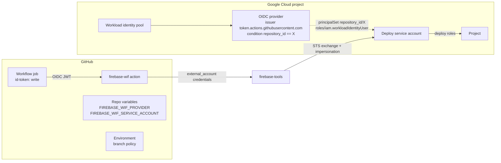

# firebase-wif specs

These are living specs: each describes how a feature should ideally work. When the code differs from a spec, the code is what changes, unless the spec is wrong, in which case the spec is fixed first. This page is the overview.

## What firebase-wif is

firebase-wif makes it easy to deploy to Firebase from GitHub Actions through Google Cloud Workload Identity Federation (WIF), so a repo needs no service account keys or `FIREBASE_TOKEN`. It has three parts, all in the `@abraham/firebase-wif` package and this repo:

1. **Node API** (`import { status, setup } from '@abraham/firebase-wif'`): the reconcile engine as a library. CLI projects call it instead of implementing WIF setup themselves.
2. **CLI** (`npx @abraham/firebase-wif`), a thin layer over the API:
   - `status` checks, without changing anything, whether the Google Cloud project and the GitHub repo are set up correctly.
   - `setup` creates or repairs everything on both sides, and is safe to re-run.
3. **GitHub Action** (`abraham/firebase-wif`): turns the job's GitHub OIDC token into Google credentials that work with common Firebase deploy tools.

## Goals

- One command that sets up any repo and project, and is safe to re-run.
- Clear, actionable diagnostics for each piece of the trust chain. WIF failures are otherwise opaque ("Permission denied" from STS).
- A deploy step that's one `uses:` plus the deploy command, and works with the existing Firebase actions without forking them.
- No secrets: GitHub repo variables only, and no service account keys.
- Least privilege by default: Hosting deploys only, trusted for one repository by its immutable numeric ID.
- Embeddable: every CLI capability is a typed, side-effect-free Node API.

## Non-goals

- Deleting or tearing down resources. `setup` never deletes resources; the only exception is opt-in `--prune` of roles on a service account firebase-wif manages.
- Deleting legacy credentials (key secrets, service account keys) or broad grants. `status` reports them; removing them is up to the user.
- Writing or modifying workflow files. The README has copy-paste examples.
- CI providers other than GitHub Actions, and GitHub Enterprise Server.
- Role presets beyond Hosting, Firestore, Storage, and Functions. Other roles go through `--role`.
- Replacing `firebase-tools` or the existing deploy actions.

## How it fits together



`setup` creates the Google Cloud side (APIs, pool, provider, service account, IAM bindings) and the GitHub side (repo variables, environment). `status` reads the same resources and reports what `setup` would change. The Action runs in the deploy job and produces credentials that Google client libraries exchange for a short-lived token for the service account.

## Architecture

One TypeScript package (ESM, Node `>=22`). The library is the core; the CLI and the Action are thin layers over it.

```
action.yml                 GitHub Action metadata (node24, main + post)
dist/action/               esbuild bundles of src/action, committed for the Action
src/
  index.ts                 public Node API: status, plan, setup, resolveContext, clients, errors, types
  credentials.ts           public: external_account config builder and verifier
  presets.ts               public: role and API presets
  gh.ts                    public: GitHub client that goes through the gh CLI
  testing/                 public: in-memory Google and GitHub fakes, configured scenarios
  cli/                     argument parsing, options, output, prompts, status and setup runs, bin entry point
  action/                  Action main and post steps, and a minimal @actions/core replacement
  core/                    private; layers only import downward (test/structure.test.ts)
    types.ts, errors.ts    public types, FirebaseWifError, HttpError
    naming.ts, policy.ts   default names and validation; IAM policy helpers and condition analysis
    discovery/             the only code that reads files, the environment, or runs commands:
                           context and alias discovery, file readers, exec, fetch clients and credential lookup
    io/                    per-run state and memoized reads, Google reads, endpoints, polling, retries,
                           IAM policy read-modify-write
    resources/             one file per reconcile resource (evaluate and apply), and the registry in setup order
    checks/                advisory checks (local, Google Cloud, GitHub), workflow analysis, sub estimate
    engine/                status, plan, setup; inspect, apply, permissions, trust-chain naming, adoption,
                           and the catalog of every check in report order
test/                      mirrors src/; every source file has a matching test file
```

Design rules that every feature follows:

- **One reconcile engine.** `status` and `setup` share the same code path. `status` reports a non-empty diff as a failure, and `setup` applies it, so `status` can't pass while `setup` still has work to do.
- **Direct REST calls** with `fetch` for both Google Cloud and GitHub. `gcloud` and `gh` are only optional credential sources.
- **Dependency injection.** Clients, `sleep`, events, and prompts are passed in, so tests run the real engine against the fakes in `src/testing/` with no network or timers.
- **Minimal dependencies.** `yaml` for workflow scanning, and `google-auth-library` as an optional dependency for Application Default Credentials. The Action bundle contains only this package's code.

## Specs

| Spec                                                       | Covers                                                                                                                                                    |
| ---------------------------------------------------------- | --------------------------------------------------------------------------------------------------------------------------------------------------------- |
| [`trust-chain.md`](trust-chain.md)                         | What has to exist, default naming, the provider's attribute mapping and condition, repo-ID pinning                                                        |
| [`reconcile.md`](reconcile.md)                             | `status`, `plan`, and `setup` semantics: resource order, re-reading before writes, retries, long-running operations, partial failure, `--prune`, adoption |
| [`checks.md`](checks.md)                                   | Every check ID, its severity, and its fix                                                                                                                 |
| [`context-and-credentials.md`](context-and-credentials.md) | Project and repo discovery, credential lookup order, the operator permission preflight                                                                    |
| [`presets.md`](presets.md)                                 | Roles and APIs per product, functions runtime service account grants                                                                                      |
| [`multi-project.md`](multi-project.md)                     | Home and other projects, the `home` option, `--all-aliases`                                                                                               |
| [`cli.md`](cli.md)                                         | Commands, flags, human and `--json` output, exit codes, prompts                                                                                           |
| [`action.md`](action.md)                                   | Inputs, outputs, the credentials file, verification and its error mapping, masking, bundling                                                              |
| [`node-api.md`](node-api.md)                               | Entry points, types, the library contract, the `/testing` fakes                                                                                           |
| [`release-and-ci.md`](release-and-ci.md)                   | Versioning and tags, npm publishing, CI checks, the demo deploy, Dependabot                                                                               |

### Writing a spec

Each spec starts with the files it covers, so it's easy to see when a change needs a spec update:

```md
# Checks

Code: `src/core/checks/`, `src/core/engine/catalog.ts`
Tests: `test/core/checks/`, `test/core/engine/catalog.test.ts`
```

Then it describes the ideal behavior as settled decisions, not open questions or a roadmap. Each spec ends with "Security" (what the feature must never do) and "How it's tested" sections. Open questions go in issues, not specs.

Check IDs, CLI flags and exit codes, Action inputs and outputs, `Change.action` values, `FirebaseWifError.code` values, and exported functions and types are public API. Changing them is a breaking change under the versioning rules in `release-and-ci.md`.

## Security summary

- **Trust is pinned to the numeric repository ID** (and the owner ID when firebase-wif writes the condition), never only to `owner/name` strings. `setup` never re-points a provider that trusts another repository.
- **No secrets are written to GitHub**, only variables. `status` warns about leftover key secrets and service account keys.
- **The credentials file is a secret for the job's lifetime**, because it holds the job's OIDC request token. The Action masks it, writes it with mode `0600` outside the workspace, and deletes it in the post step.
- **The library never surfaces tokens** in results, events, or errors, and wraps errors from injected clients.
- **Least privilege.** Deploy roles come from presets; `roles/iam.serviceAccountUser` is granted on runtime service accounts, never at the project level.
- **No shell interpolation.** Credential helpers run `gcloud` and `gh` with `execFile`, and every ID is validated before it's used in a URL.

## Glossary

- **WIF**: Workload Identity Federation. Lets an external identity (here, a GitHub Actions OIDC token) act as a Google Cloud service account without a key.
- **Pool / provider**: the Google Cloud resources that hold the trust configuration. The provider names GitHub's OIDC issuer and the attribute condition.
- **Attribute condition**: the expression on the provider that decides which tokens are accepted, for example `assertion.repository_id == '123'`.
- **Principal set**: the IAM member `principalSet://.../attribute.repository_id/<id>` that stands for every token from one repository.
- **Deploy service account**: the service account the workflow acts as; it holds the deploy roles.
- **Home project**: the project that holds the pool, provider, and service account. Other projects only grant deploy roles to that service account.
- **Trust chain**: the pool, provider, service account, workload identity binding, and repo variables together.
- **Reconcile resource**: one piece of setup with a read/diff (its `status` check) and an apply step.
- **Advisory check**: a `status` check with no setup step, such as leftover key secrets.
- **Preset**: a named set of deploy roles and APIs for one Firebase product.
